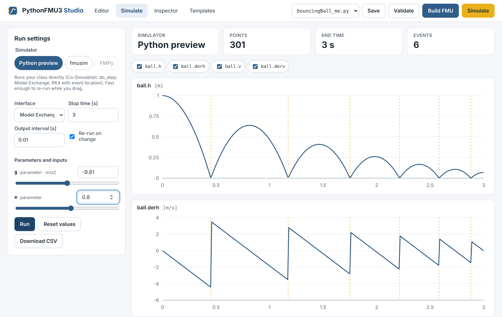
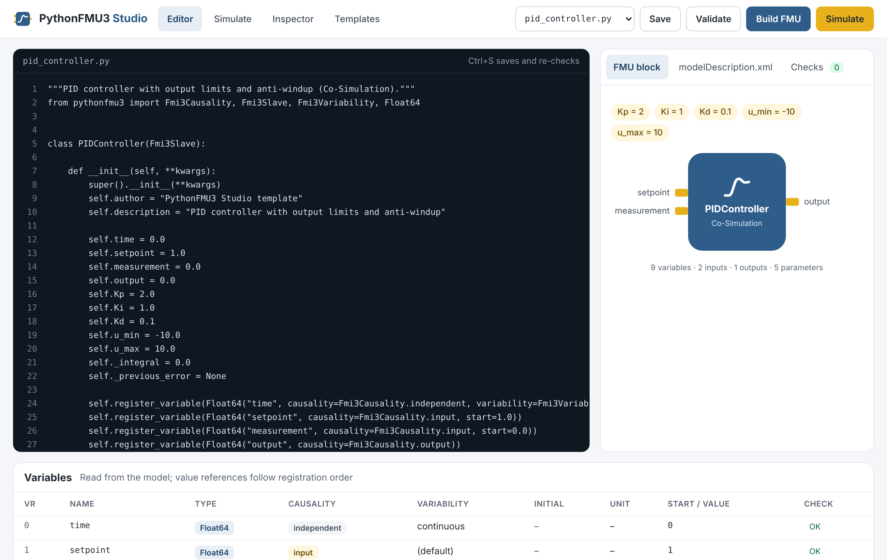
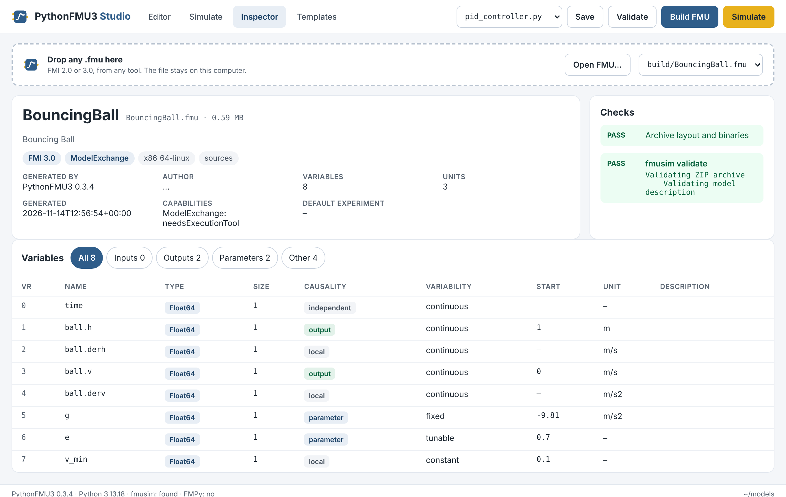
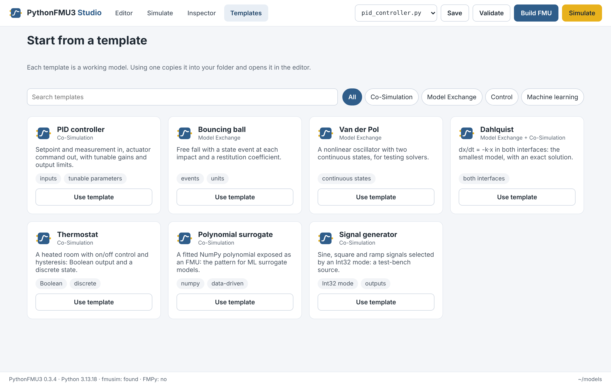

# PythonFMU3 Studio

PythonFMU3 Studio is a local web app for writing, checking, simulating, building and
inspecting FMUs. It ships with PythonFMU3, needs no extra packages, and runs entirely on
your computer.



## Getting started

### Install

From PyPI:

```bash
python3 -m venv .venv
source .venv/bin/activate          # Windows: .venv\Scripts\activate
pip install pythonfmu3 numpy
```

From a clone of the repository (for development), install it in editable mode instead:

```bash
cd PythonFMU3
python3 -m venv .venv
source .venv/bin/activate
pip install -e . numpy
```

NumPy is only needed by models that use arrays and by the polynomial-surrogate
template.

### Build the native library (source installs only)

Building an FMU needs PythonFMU3's compiled library for your platform. PyPI packages
include it for Windows and Linux x86_64. In a clone, or on macOS and ARM, build it once
with CMake and a C++17 compiler:

```bash
cmake -S pythonfmu3/pythonfmu-export -B build -DCMAKE_BUILD_TYPE=Release
cmake --build build --config Release
```

The library is written to `pythonfmu3/resources/binaries/<platform>/`, for example
`aarch64-darwin` on Apple Silicon. Without it, the editor, the Python preview, the
Inspector and the templates still work, but built FMUs contain no binaries and can't be
simulated (see [Troubleshooting](#troubleshooting)).

### Start the Studio

```bash
pythonfmu3 studio                  # use the current folder as the workspace
pythonfmu3 studio my_models        # or another folder
```

The command prints a link and opens it in your browser. Keep the terminal open while you
work; press Ctrl+C there to stop the Studio.

### Optional tools

| Tool | Enables | Install |
| --- | --- | --- |
| [fmusim](https://github.com/modelica/fmusim) | Full validation, and simulating the built FMU in a native (non-Python) importer | Download the release for your platform and put `fmusim` on your `PATH`, or set `PYTHONFMU3_FMUSIM` to its full path |
| [FMPy](https://github.com/CATIA-Systems/FMPy) | Simulating the built FMU with FMPy | `pip install fmpy` |

The status bar at the bottom of the Studio shows which of these were found.

## Editor



- Choose a model from the file menu at the top. Every `.py` file in the workspace is
  listed. Edit it and save with **Ctrl+S** (**Cmd+S** on macOS), or the **Save** button.
- Each save loads the model in a separate Python process and checks it. The right-hand
  panel has three tabs:
    - **FMU block:** inputs on the left, outputs on the right, parameters on top.
    - **modelDescription.xml:** exactly what will go into the FMU.
    - **Checks:** problems found in the model; the number next to the tab is how many.
- The **Variables** table lists every registered variable with its value reference,
  type, causality, variability, unit and start value, and flags problems per variable.
- **Build FMU** writes the FMU to `build/` in the workspace and offers a download.
- **Validate** builds the FMU and checks it with fmusim, or runs basic archive checks if
  fmusim isn't installed.

### What the checks catch

| Check | Why it matters |
| --- | --- |
| No independent variable | FMI 3.0 expects the time variable to be declared: register a `Float64` with `causality=Fmi3Causality.independent`. |
| Input or parameter not settable | `register_variable` only creates a setter if the attribute already exists, so importers can't set it. Create the attribute first, or pass `setter=`. |
| Integer, Boolean or String marked continuous | Only `Float64` variables can be continuous; use `discrete`, or `fixed`/`tunable` for parameters. |
| Name starting with `_` | PythonFMU3 strips leading underscores when it looks up the attribute, so `_x` reads `self.x`. |
| Class attribute ignored | `author`, `description`, `license`, `version` and `copyright` must be set in `__init__` (`self.author = ...`); class-level values don't reach the model description. |
| Model description can't be generated | Any error raised while building the model description, with its message. |

If the model can't be loaded at all, for example because of a syntax error, the Checks
tab shows the Python traceback.

## Simulate

Choose a simulator, set the stop time and output interval, and press **Run**.

| Simulator | What it does |
| --- | --- |
| Python preview | Runs your class directly: `do_step` at each output interval for Co-Simulation, and a fixed-step RK4 integrator with event location for Model Exchange. No FMU is built, so it's quick. |
| fmusim | Builds the FMU and runs it in fmusim, a native importer, the way most simulation tools would load it. |
| FMPy | Builds the FMU and runs it with FMPy. |

- For models that support both interfaces, choose Co-Simulation or Model Exchange under
  **Interface**.
- Every scalar parameter and input gets a number box and a slider. With **Re-run on
  change** ticked, the Python preview re-runs as you drag. **Reset values** returns to
  the model's start values.
- Tick the variables to plot. Hover a chart to read values; dashed lines mark events.
- **Download CSV** saves the result.
- Anything your model prints, and the simulator's log, appears under **Output and log**.

The Python preview is meant for quick checks while you edit. Use fmusim or FMPy to
confirm the built FMU behaves the same in an importer.

## Inspector



Drop any `.fmu` file on the Inspector, use **Open FMU…**, or pick an FMU from the
workspace. It works with FMI 2.0 and 3.0 FMUs from any tool, and shows:

- the model name, description, FMI version, interfaces, platforms with binaries, and
  whether sources are included;
- who generated it and when, its capabilities, units and default experiment;
- every variable, filterable by inputs, outputs, parameters and other;
- archive checks, such as a missing binary for a listed platform, and the fmusim
  validation result when fmusim is installed.

Uploaded FMUs are only read, never run.

## Templates



Start a new model from a working template. **Use template** copies it into the workspace
under a new name, such as `thermostat.py` or `thermostat_2.py`, and opens it in the
editor.

| Template | Interface | Shows |
| --- | --- | --- |
| PID controller | Co-Simulation | Inputs, tunable parameters, output limits and anti-windup |
| Bouncing ball | Model Exchange | State events and units |
| Van der Pol | Model Exchange | Two continuous states |
| Dahlquist | Both | The same model in both interfaces, with an exact solution |
| Thermostat | Co-Simulation | Boolean output, discrete state, units with an offset |
| Polynomial surrogate | Co-Simulation | A data-driven model with NumPy: the pattern for ML surrogates |
| Signal generator | Co-Simulation | An `Int32` mode parameter selecting the signal |

## Command-line options

```
pythonfmu3 studio [folder] [--port PORT] [--no-browser]
```

| Option | Meaning |
| --- | --- |
| `folder` | The workspace (default: the current folder). Only files inside it are read or written. |
| `-p`, `--port` | Port to listen on (default: any free port). |
| `--no-browser` | Don't open a browser; open the printed link yourself. |

## Security

- The server listens only on `127.0.0.1`, so other computers can't reach it.
- Every request needs the access token from the printed link, and must be addressed to
  `127.0.0.1` or `localhost`. That stops other web pages open in your browser from using
  it.
- Only the workspace folder is read or written. Uploaded FMUs go to a temporary folder
  that is deleted when the Studio stops.
- Model code runs in a separate Python process for each request, so an error or crash in
  your model can't take the Studio down.

The Studio runs the Python code in your models, just as building an FMU does. Only open
workspaces you trust, and don't expose the Studio over a network.

## Troubleshooting

### `command not found: pythonfmu3`

PythonFMU3 isn't installed in the active Python environment. Activate your virtual
environment (`source .venv/bin/activate`) and install it (see [Install](#install)), or
run `python -m pythonfmu3 studio` from an environment where it is installed.

### "Built … · no binaries"

The FMU was built without PythonFMU3's native library for your platform, so simulators
can't load it. Build the library as described in
[Build the native library](#build-the-native-library-source-installs-only), then build
the FMU again.

### fmusim or FMPy buttons are greyed out

The tool wasn't found. Put `fmusim` on your `PATH` (or set `PYTHONFMU3_FMUSIM`) or
`pip install fmpy`, then restart the Studio.

### "Missing access token" or "Missing or invalid token"

Open the Studio with the full link printed in the terminal; the token changes every
time the Studio starts.

### The model fails to load

The Checks tab shows the Python traceback. Check that the script defines exactly one
class inheriting `Fmi3Slave` (or `Fmi3SlaveBase` with a mixin), and that any packages
it imports are installed in the same environment as PythonFMU3.

### The page doesn't open automatically

Copy the printed link into your browser, or start with `--no-browser` and open it
yourself.
