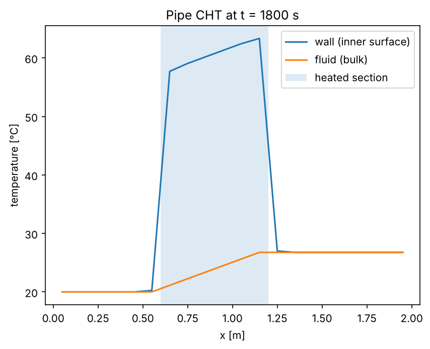

# 1D pipe flow for conjugate heat transfer (CHT)

`pipe1d.py` models flow and heat transfer in a pipe in 1D (along its axis), as a
co-simulation FMU meant to be coupled to a solid solver. The pipe wall, or any solid
around it, is resolved by that solver, typically in 3D. Only the fluid is in the FMU.



## Coupling

The pipe is split into `N_SEGMENTS` equal axial segments. The FMU and the solid solver
exchange one value per segment, every communication step:

| Direction | Variable | Meaning |
| --- | --- | --- |
| solid → FMU | `T_wall[i]` | wetted-wall temperature of segment *i*, area-averaged by the solid solver [K] |
| FMU → solid | `T_fluid[i]` | bulk fluid temperature of segment *i* [K] |
| FMU → solid | `h[i]` | heat transfer coefficient of segment *i* [W/(m²·K)] |

On the wetted surface of segment *i*, the solid solver applies a convective (Robin) boundary
condition: `q'' = h[i] · (T_surface − T_fluid[i])`. This is the usual stable way to couple
CHT. If your solver needs a heat flux instead, `q_wall[i]` (W/m², wall → fluid) and
`Q_wall[i]` (W per segment) are also outputs.

One coupling step (what `cht_demo.py` does):

1. solid → FMU: set `T_wall`.
2. `doStep(t, dt)` on the FMU.
3. FMU → solid: get `T_fluid` and `h`.
4. Advance the solid by `dt` with those boundary conditions.

## Parameters

| Name | Default | Unit | Meaning |
| --- | --- | --- | --- |
| `length` | 2.0 | m | pipe length |
| `diameter` | 0.02 | m | inner (hydraulic) diameter |
| `rho` | 992.2 | kg/m³ | fluid density |
| `cp` | 4179 | J/(kg·K) | fluid specific heat |
| `k_fluid` | 0.631 | W/(m·K) | fluid thermal conductivity |
| `mu` | 6.53e-4 | Pa·s | fluid dynamic viscosity |
| `T_initial` | 293.15 | K | initial fluid temperature |
| `N_SEGMENTS` | 20 | – | number of axial segments: a constant at the top of `pipe1d.py`, so edit it and rebuild the FMU to change it |

The fluid properties are constant; the defaults are water at about 40 °C. The parameters
are fixed, so set them before `fmi3ExitInitializationMode`.

## Inputs and outputs

| Name | Causality | Unit | Meaning |
| --- | --- | --- | --- |
| `m_dot` | input | kg/s | mass flow; positive from x = 0 to x = L. Negative values (reverse flow) are supported |
| `T_in` | input | K | temperature of the fluid entering at the upstream end |
| `T_wall[N]` | input | K | wall temperature per segment |
| `T_fluid[N]` | output | K | bulk fluid temperature per segment |
| `h[N]` | output | W/(m²·K) | heat transfer coefficient per segment |
| `q_wall[N]`, `Q_wall[N]` | output | W/m², W | heat from the wall into the fluid, per segment |
| `T_out` | output | K | outlet temperature |
| `Q_total` | output | W | total heat from the wall into the fluid |
| `Re`, `Nu` | output | – | Reynolds and Nusselt numbers |
| `dp` | output | Pa | frictional pressure drop |
| `x[N]` | calculated parameter | m | segment centres, for mapping segments onto the solid mesh |

## Model

- **Energy:** finite volume, first-order upwind, implicit Euler:
  `ρ·cp·A·Δx·dTᵢ/dt = ṁ·cp·(T_upstream − Tᵢ) + hᵢ·P·Δx·(T_wall,ᵢ − Tᵢ)`.
  The system is solved in one O(N) sweep along the flow and is stable for any
  communication step, so the coupling step can follow the solid solver's time step.
- **Heat transfer:** fully developed flow. Nu = 3.66 when laminar (Re < 2300),
  Gnielinski when turbulent (Re > 4000), blended linearly in between.
- **Friction:** f = 64/Re when laminar, Petukhov when turbulent.
- **Not modelled:** entrance effects, property variation with temperature, axial
  conduction in the fluid, and phase change.

## Running it

```bash
pip install pythonfmu3 numpy
pythonfmu3 build -f pipe1d.py          # creates Pipe1D.fmu

python cht_demo.py                      # Python class + simple solid model
python cht_demo.py --fmu Pipe1D.fmu     # same coupling through the FMU (needs FMPy)
python cht_demo.py --plot profile.png   # save the temperature profile (needs matplotlib)
```

The demo heats the middle third of a steel tube (outer diameter 30 mm) with 50 kW/m² on
its outer surface, with water at 0.1 kg/s (Re ≈ 9700). The solid is a small axisymmetric
conduction model standing in for your 3D solver. At steady state, the water's enthalpy
rise matches the heater power.

To use your own solver instead, replace the `SolidWall` class: area-average your solver's
wetted-wall temperature over each axial segment (use `x` and `length` to map your mesh
faces to segments) to get `T_wall`, and apply each segment's `h` and `T_fluid` as that
segment's convective boundary condition. The model is unchanged when the pipe sits
inside a larger solid, or is one of several channels.
